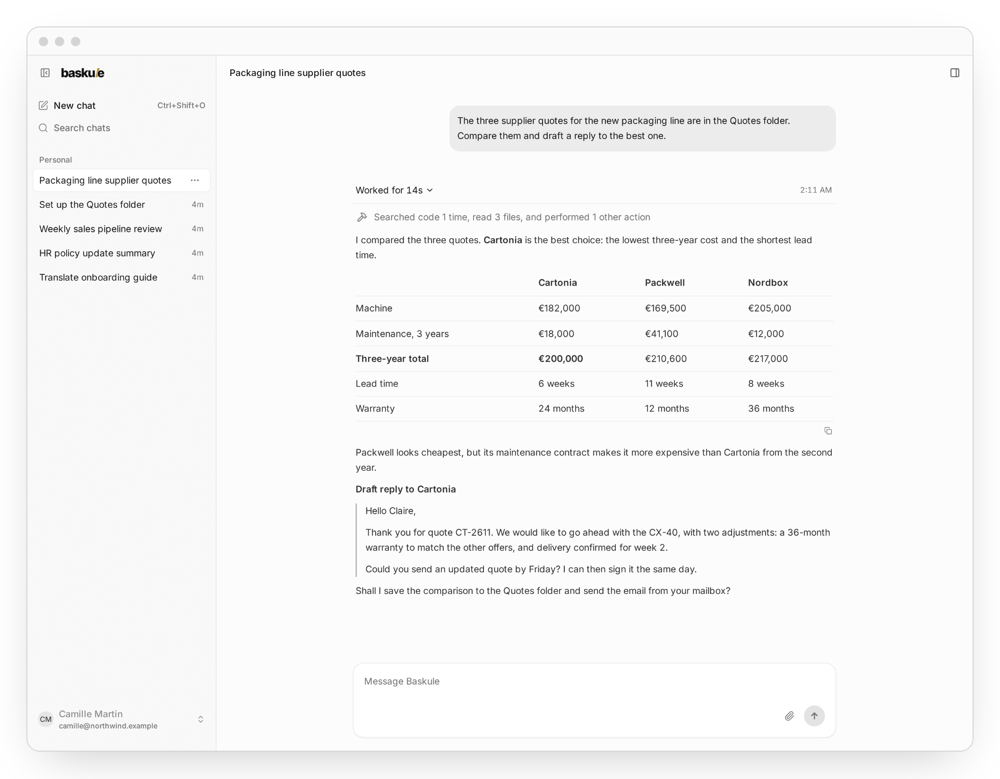
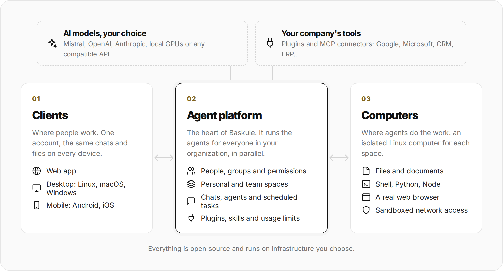

<p align="center">
  <picture>
    <source media="(prefers-color-scheme: dark)" srcset="brand/wordmark-inverse.svg">
    
  </picture>
</p>

<h3 align="center">Self-hosted AI agents for your whole team.</h3>

Baskule is an open-source agent platform that you run on your own servers. Your team chats with agents from the web,
desktop and mobile apps.

Pick any model provider or run your own local model, host it anywhere from one machine to a cluster, and fork and
customize it under the MIT licence.

> [!NOTE]
> Baskule is under active development. Expect breaking changes between releases.

<p align="center">
  <picture>
    <source media="(prefers-color-scheme: dark)" srcset="docs/readme/product-dark.png">
    
  </picture>
</p>

## How it works

Baskule has three parts:

- **Clients.** Web, desktop and mobile apps built on [T3 Code](https://github.com/pingdotgg/t3code). One account,
  the same conversations on every device.
- **Agent platform.** People, groups, personal and team spaces, plugins and usage. It runs an
  [OpenCode](https://github.com/anomalyco/opencode) agent for every conversation. It scales with your usage, from a
  single computer to a cluster.
- **Computers.** Each space gets an isolated Linux computer with a shell, Python, Node, a browser and office tools,
  managed by Docker on one machine or agent-sandbox on Kubernetes. It starts when an agent needs it and stops
  when idle.

<p align="center">
  <picture>
    <source media="(prefers-color-scheme: dark)" srcset="docs/readme/architecture-dark.png">
    
  </picture>
</p>

What Baskule connects to in your environment:

| | |
| --- | --- |
| Model | OpenAI, Anthropic, Mistral, or any OpenAI-compatible endpoint, including your own private local model. |
| Sign-in | Google, Microsoft, GitHub or any OIDC provider, or passwords. |
| Tools | MCP servers and plugins, using the organization's account or each person's own. |
| Storage | All data lives in one S3-compatible bucket, or on the machine's disk. |
| Network | One HTTP port, behind your HTTPS reverse proxy. |
| Monitoring | OpenTelemetry traces. |

## Install

### The clients

Most people only need a client. Ask your administrator for your server's address, then sign in from any of these:

| Client | Status | Download |
| --- | --- | --- |
| Web | Available | Served by your Baskule server at its address |
| Linux | Available | [AppImage (x64)](https://github.com/baskule/baskule/releases/latest) |
| Android | Preview | [APK (arm64)](https://github.com/baskule/baskule/releases/latest/download/Baskule-android-arm64-release-debug-signed.apk) |
| macOS | Preview, unsigned | [DMG (Apple silicon or Intel)](https://github.com/baskule/baskule/releases/latest) |
| Windows | Preview, unsigned | [Installer (x64)](https://github.com/baskule/baskule/releases/latest) |
| iOS | Not available yet | — |

_The macOS, Windows and Android apps are not signed yet, and no app is published on an app store. Your system will
warn before opening them. There is no iOS app yet._

### The server

```sh
curl -fLO https://github.com/baskule/baskule/releases/latest/download/docker-compose.yml
docker compose up -d
docker compose logs setup        # prints the one-time link that creates the first admin
```

Open the setup link to create the first admin; see [configuration and built-in HTTPS](docs/install.md), or the [Kubernetes guide](docs/install-kubernetes.md) for several machines.

Optional: [sync plugins from a folder](docs/install.md#plugins-folder).

## Built on

- [T3 Code](https://github.com/pingdotgg/t3code): the clients and the chat engine started as a fork (MIT).
- [OpenCode](https://github.com/anomalyco/opencode): the agent.
- [celld](https://github.com/denoland/celld): the runtime of the agent platform.
- [Better Auth](https://github.com/better-auth/better-auth), [Drizzle ORM](https://github.com/drizzle-team/drizzle-orm),
  [RustFS](https://github.com/rustfs/rustfs), [Caddy](https://github.com/caddyserver/caddy),
  [Jaeger](https://github.com/jaegertracing/jaeger), [Playwright MCP](https://github.com/microsoft/playwright-mcp),
  [LibreOffice](https://www.libreoffice.org) and [pandoc](https://pandoc.org).

## Licence

Baskule is released under the [MIT licence](LICENSE). Included third-party code keeps its own licence, including the [T3 Code licence](app/LICENSE). See [third-party notices](THIRD_PARTY_NOTICES.md) and
[source provenance](source-provenance.json).
