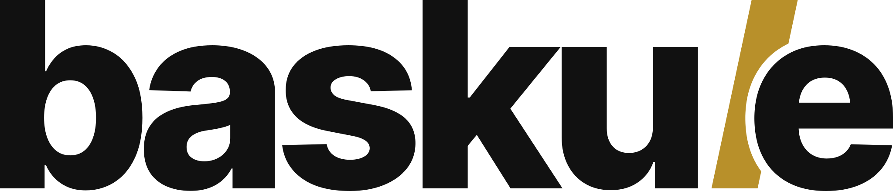
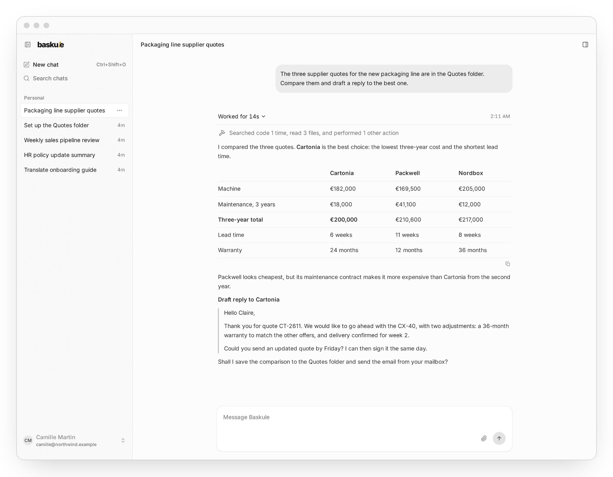
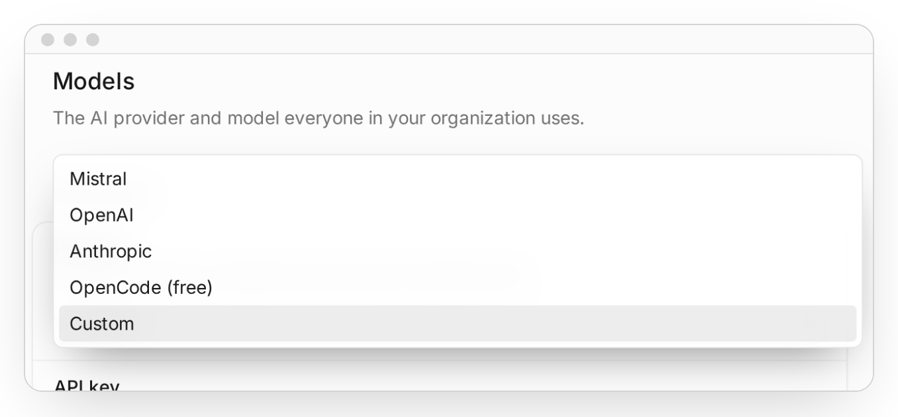
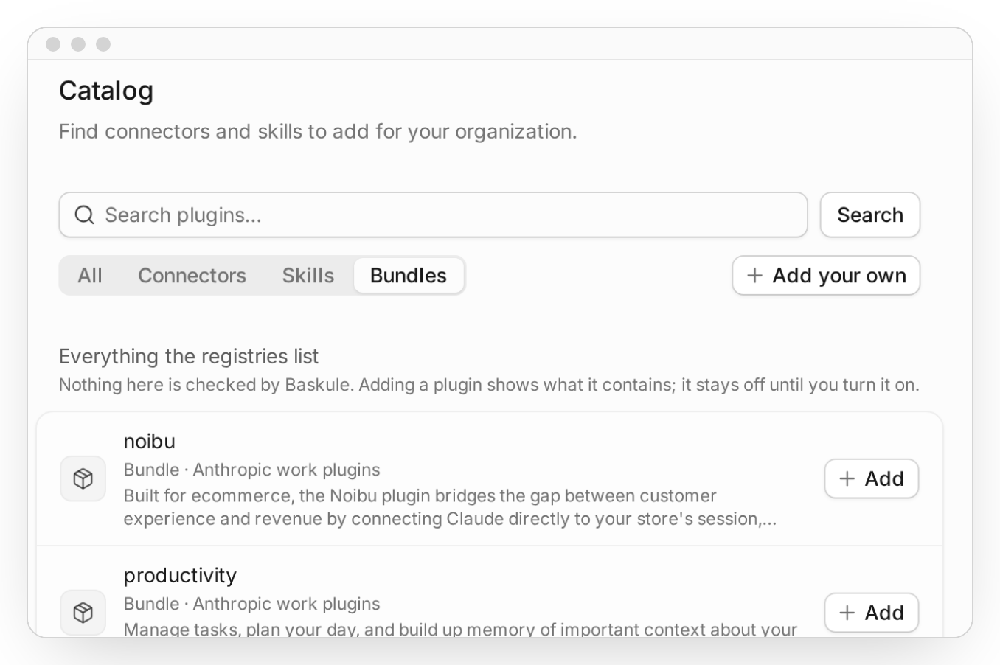
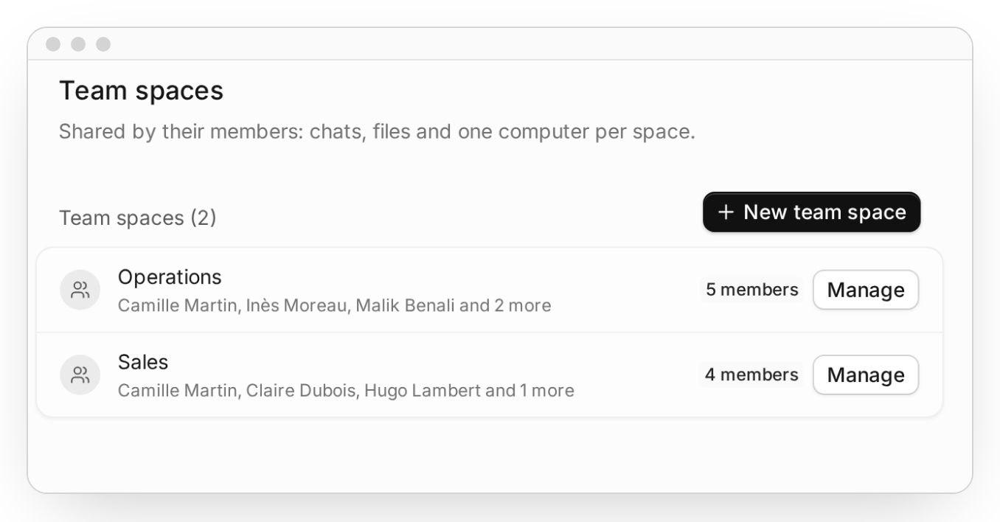
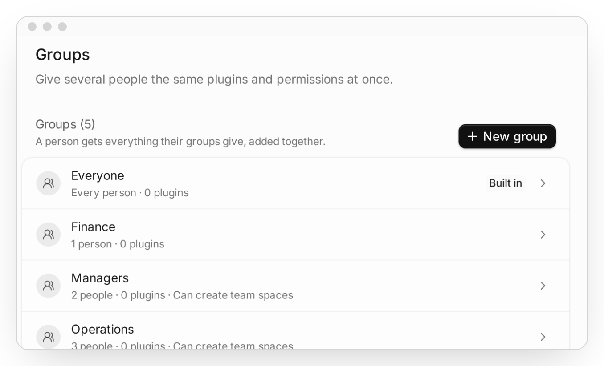
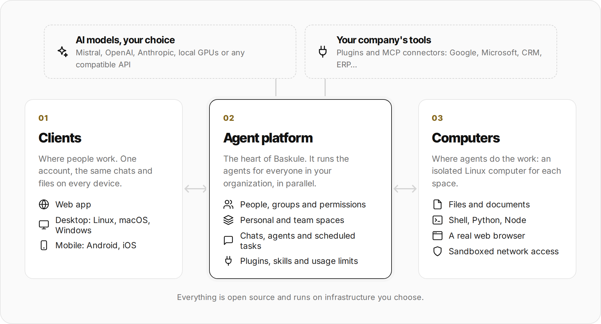
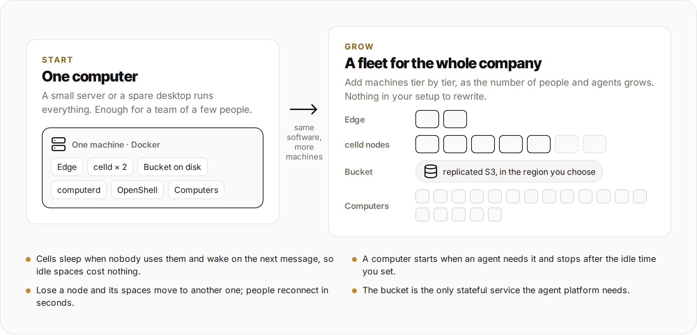
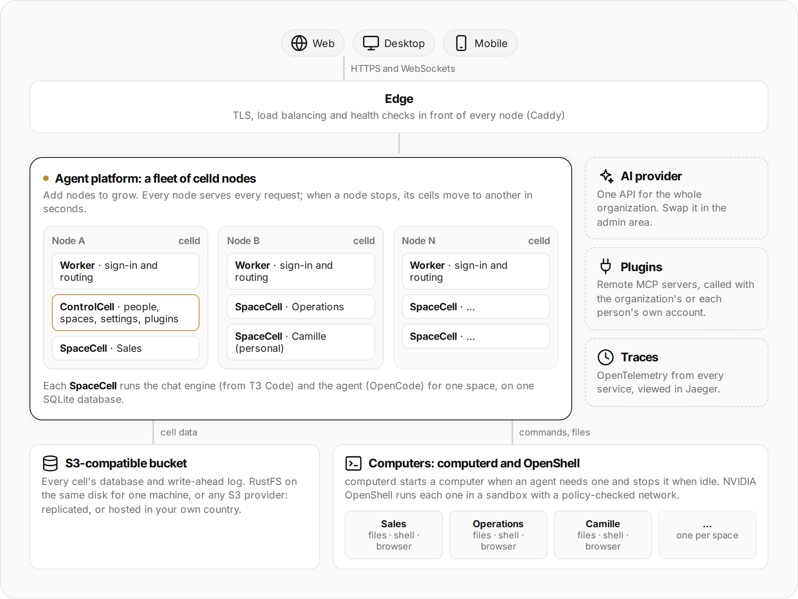

<p align="center">
  <picture>
    <source media="(prefers-color-scheme: dark)" srcset="docs/readme/wordmark-inverse.svg">
    
  </picture>
</p>

<h3 align="center">The open-source agent platform your company owns.</h3>

<p align="center">
  Your teams hand real work to AI agents that read your documents, use your tools and have a computer of their own.<br>
  You choose the models, the servers and the rules. Nothing is rented, and nothing is locked in.
</p>

<p align="center">
  <a href="#install-it">Install</a> ·
  <a href="#how-it-is-built">How it works</a> ·
  <a href="#what-is-available-today">What is available</a> ·
  <a href="docs/install.md">Installation guide</a> ·
  <a href="LICENSE">MIT licence</a>
</p>

<p align="center">
  <picture>
    <source media="(prefers-color-scheme: dark)" srcset="docs/readme/product-dark.png">
    
  </picture>
</p>

> [!NOTE]
> Baskule is under active development. New features and releases land often; the
> [status table](#what-is-available-today) shows what is ready and what is coming.

## From answers to work done

Most teams already use AI to get answers. They still do the work around it themselves: finding the right file,
copying text between tools, turning a reply into a document, chasing the next step.

Baskule gives each person and each team an agent that does that work. It opens the folder, reads the quotes,
compares them, writes the email and saves the spreadsheet. People describe the goal, check the result and decide.

## Own the whole car

Think of the AI model as fuel and the agent as the engine. What people actually use is the car around them: the
apps, the shared spaces, the permissions, the connections to your company's systems. Most AI suites lease you that
car. They choose the fuel, keep the car in their garage and change the terms when they like.

Baskule gives you the keys.

| | A typical hosted AI suite | Baskule |
| --- | --- | --- |
| **Models** | The vendor's own | Any provider: Mistral, OpenAI, Anthropic, a free model, or your own GPUs. Switch at any time. |
| **Where it runs** | The vendor's cloud | One computer in your office, your data center, or a cloud in the country you choose |
| **Your data** | In the vendor's account | In your own storage bucket |
| **The software** | Closed, rented per seat | Open source under the MIT licence. Read it, change it, extend it. |
| **Leaving** | Start over | Take your data and reinstall it anywhere, with or without us |

The goal is simple: you build your own agentic system to run and improve your company, and you stay in charge of
every part of it.

## What your team gets

<table>
  <tr>
    <td width="50%" valign="top">
      <h4>Any model, swapped in one click</h4>
      <p>Pick Mistral, OpenAI, Anthropic, a free model, or any OpenAI-compatible endpoint, including a model running
      on your own network. Baskule checks the key and the model before it saves anything.</p>
      <picture>
        <source media="(prefers-color-scheme: dark)" srcset="docs/readme/models-dark.png">
        
      </picture>
    </td>
    <td width="50%" valign="top">
      <h4>Plugins for your company's tools</h4>
      <p>Add connectors, skills and plugin bundles from public catalogs (the official MCP Registry, Anthropic's and
      OpenAI's plugin catalogs) or from your own address. Nothing runs until an admin turns it on for a group.</p>
      <picture>
        <source media="(prefers-color-scheme: dark)" srcset="docs/readme/plugins-dark.png">
        
      </picture>
    </td>
  </tr>
  <tr>
    <td width="50%" valign="top">
      <h4>Personal and team spaces</h4>
      <p>Everyone gets a private space. Teams share spaces with their chats, files and their own computer, so the
      sales team's agent works on the sales team's documents.</p>
      <picture>
        <source media="(prefers-color-scheme: dark)" srcset="docs/readme/spaces-dark.png">
        
      </picture>
    </td>
    <td width="50%" valign="top">
      <h4>People, groups and permissions</h4>
      <p>Invite people, sign in with passwords, Google, Microsoft, GitHub or your company's single sign-on, and give
      each group the plugins and permissions it needs.</p>
      <picture>
        <source media="(prefers-color-scheme: dark)" srcset="docs/readme/groups-dark.png">
        
      </picture>
    </td>
  </tr>
</table>

And more, out of the box:

- **Agents that use a real computer.** Files, a shell, Python and Node, a web browser that people can watch while the
  agent drives it, and tools to read and write Word, Excel, PowerPoint and PDF files.
- **Accounts that stay personal.** A plugin can act with each person's own Google or Microsoft account, so the agent
  only sees what that person is allowed to see.
- **Scheduled tasks.** Ask for a Monday-morning pipeline summary once, and it arrives every Monday.
- **Usage and limits.** See usage by person, model and space, export it to CSV, and set daily, weekly or monthly
  limits per person.
- **Voice input.** Dictate a message instead of typing it.
- **Every device.** The same account, chats and files on the web, on the desktop and on the phone.

## How it is built

Baskule has three parts. People use the **clients**. The **agent platform** runs everyone's agents and holds the
organization together. The **computers** are where the agents do the work.

<p align="center">
  <picture>
    <source media="(prefers-color-scheme: dark)" srcset="docs/readme/architecture-dark.png">
    
  </picture>
</p>

**1. Clients.** A web app, desktop apps and mobile apps, all signed in to the same account. A chat started on a
laptop continues on a phone. Desktop and mobile apps connect to any Baskule installation by its address or a QR code.

**2. The agent platform.** It manages people, groups, spaces, plugins, usage and the AI connection. Each space has
its own chat engine and agent, and many spaces run side by side. Spaces sleep when nobody uses them and
wake on the next message.

**3. Computers.** Each space gets an isolated Linux computer with its own disk, started when an agent needs it and
stopped when it is idle. Its network access is checked against a policy, and it can never reach your private
network or the platform's internal services.

## What is available today

| Part | Item | Status |
| --- | --- | --- |
| Clients | Web app | 🟢 Available |
| | Linux desktop app (AppImage, tar.gz) | 🟢 Available |
| | Android app (APK) | 🟢 Available, outside the Play Store for now |
| | macOS desktop app | 🟡 Preview: builds today, signed releases coming |
| | Windows desktop app | 🟡 Preview: builds today, signed releases coming |
| | iOS app | ⚪ Not available yet |
| Platform | Single-machine installation | 🟢 Available |
| | Several platform nodes with automatic failover | 🟢 Available |
| | External S3-compatible storage | 🟢 Available |
| | Mistral, OpenAI, Anthropic, OpenCode (free) and custom endpoints | 🟢 Available |
| | Several models offered at once in one installation | ⚪ Not available yet: one model for the organization, switchable at any time |
| | Plugins: MCP connectors, skills and bundles | 🟢 Available |
| | Sign-in with passwords, Google, Microsoft, GitHub and OIDC | 🟢 Available |
| | SAML sign-in | ⚪ Not available: use your identity provider's OIDC connection |
| Computers | Computers on the platform's machine | 🟢 Available |
| | Computers spread over several machines or Kubernetes | 🟡 In progress |
| Installation | Build from source and run with Docker Compose | 🟢 Available |
| | Prebuilt images and a one-command installer | ⚪ Coming |

The native apps are built from this repository today. Ready-made downloads arrive with the first public release.

## From one computer to a fleet

Install Baskule on a single machine and it works for a team of a few people. When the whole company joins, add
machines: the same software spreads over a fleet of servers for hundreds of people and agents running in parallel.

<p align="center">
  <picture>
    <source media="(prefers-color-scheme: dark)" srcset="docs/readme/scale-dark.png">
    
  </picture>
</p>

## Under the hood

The agent platform runs on [celld](https://github.com/denoland/celld), a self-hosted runtime for distributed
Durable Objects. Every celld node can serve every request. The organization lives in one cell, the **ControlCell**,
and every space lives in its own **SpaceCell**, which runs the chat engine (derived from T3 Code) and the agent
(OpenCode) on one SQLite database. When a node stops, its cells move to another node within seconds.

<p align="center">
  <picture>
    <source media="(prefers-color-scheme: dark)" srcset="docs/readme/under-the-hood-dark.png">
    
  </picture>
</p>

**Storage is one S3 bucket.** Every cell's database and log are stored in an S3-compatible bucket. On a single
machine that is [RustFS](https://github.com/rustfs/rustfs) writing to the local disk. In production it can be any S3
provider: a replicated bucket so nothing is lost, or a sovereign provider in your own country. Backups are a copy
of that bucket and of the computers' disks.

**Computers are sandboxes.** `computerd` starts, stops and connects computers. They run in
[NVIDIA OpenShell](https://github.com/NVIDIA/OpenShell), which enforces file, process and network policy for each
one. Computers only reach the public internet, never private addresses.

**Credentials stay protected.** AI keys are write-only in the admin area. Plugin tokens and OAuth secrets are
encrypted with a key derived from the installation's secret. Sessions are checked on every request and revoked at
once when someone is removed.

**Everything is observable.** Every service sends OpenTelemetry traces to a bundled Jaeger.

## Install it

The quickest way is to let a coding agent do it. Open [Codex](https://openai.com/codex/) or
[Claude Code](https://claude.com/claude-code) on the machine that will run Baskule and paste:

```text
Install Baskule on this machine by following
https://github.com/baskule/baskule/blob/main/docs/install.md
Use local storage and password sign-in. Create the first admin account for <your email>.
Ask me before running anything with sudo, and give me the address and the admin password when it is done.
```

For a first try you need one machine running **Ubuntu 24.04 (x86-64)** with **Docker**, **4 CPU cores**,
**16 GB of memory** and **80 GB of free disk**. The first build compiles the sandbox runtime and takes a while; later
updates are quick.

Prefer to do it yourself? Follow the [installation guide](docs/install.md). It also covers HTTPS, single sign-on,
external storage, backups and updates.

## Built on the shoulders of

Baskule would not exist without these projects. Thank you to their authors and communities.

- [**T3 Code**](https://github.com/pingdotgg/t3code) by T3 Tools: the web, desktop and mobile clients and the chat
  engine started as a fork of T3 Code (MIT).
- [**NVIDIA OpenShell**](https://github.com/NVIDIA/OpenShell): the sandbox runtime for the computers, included with
  small patches (Apache 2.0).
- [**OpenCode**](https://github.com/anomalyco/opencode): the agent that runs inside every space.
- [**celld**](https://github.com/denoland/celld) by Deno: the distributed runtime of the agent platform.
- [**Better Auth**](https://github.com/better-auth/better-auth) for sign-in and sessions, and
  [**Drizzle ORM**](https://github.com/drizzle-team/drizzle-orm) for the database schema.
- [**RustFS**](https://github.com/rustfs/rustfs) for local S3 storage, [**Caddy**](https://github.com/caddyserver/caddy)
  for the edge, and [**Jaeger**](https://github.com/jaegertracing/jaeger) with
  [**OpenTelemetry**](https://opentelemetry.io) for tracing.
- [**Playwright MCP**](https://github.com/microsoft/playwright-mcp) and [**Chromium**](https://www.chromium.org) for the
  agents' browser, and [**LibreOffice**](https://www.libreoffice.org) and [**pandoc**](https://pandoc.org) for their
  documents.
- The [**Model Context Protocol**](https://modelcontextprotocol.io) and its registry for plugins, and
  [**models.dev**](https://models.dev) for model prices and limits.
- The clients are built with [React](https://react.dev), [TanStack Router](https://tanstack.com/router),
  [Tiptap](https://tiptap.dev), [Effect](https://effect.website), [Electron](https://www.electronjs.org),
  [Expo](https://expo.dev) and [React Native](https://reactnative.dev).
- The build chain uses [Node.js](https://nodejs.org), [pnpm](https://pnpm.io), [TypeScript](https://www.typescriptlang.org),
  [Vite+](https://github.com/voidzero-dev/vite-plus), [esbuild](https://esbuild.github.io), [Vitest](https://vitest.dev),
  [Rust](https://www.rust-lang.org), [Z3](https://github.com/Z3Prover/z3) and [Docker](https://www.docker.com).

Licences and notices for these projects are kept with their code; see [third-party notices](THIRD_PARTY_NOTICES.md)
and [source provenance](source-provenance.json).

## For developers

Baskule is one repository. Start with [building from source](docs/building.md), the
[development workflow](docs/development-workflow.md) and the [contribution guide](CONTRIBUTING.md).

| Directory | Contents |
| --- | --- |
| `app/` | The clients (web, desktop, mobile) and the SpaceCell chat engine, derived from T3 Code |
| `platform/` | The agent platform: sign-in, accounts, spaces, plugins and the embedded OpenCode agent |
| `computer/v2/`, `computerd/v2/` | The computer image and the service that manages computers |
| `openshell/`, `vendor/openshell/` | OpenShell packaging and its patched source |
| `desktop/` | Desktop packaging and native client checks |
| `deploy/v2/` | Docker Compose deployment, storage and operations scripts |
| `e2e/` | End-to-end journeys and integration checks |
| `scripts/`, `stack/` | Toolchain setup, development stacks and check selection |

More reading: [installation settings](docs/installation-settings.md), [hosted CI and releases](docs/ci.md),
[localization](docs/localization.md) and the [agent platform internals](platform/README.md).

## Licence

Baskule is released under the [MIT licence](LICENSE). Included third-party code keeps its own licence: the T3 Code
fork its [MIT licence](app/LICENSE), and OpenShell its [Apache 2.0 licence](vendor/openshell/LICENSE) and
[third-party notices](vendor/openshell/THIRD-PARTY-NOTICES).
