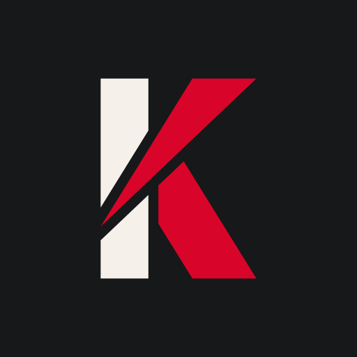

# Baskule brand

The owner approved this identity in October 2026. It replaces an earlier wordmark built around a red uppercase K.
None of that wordmark's artwork or colours remain.

| Light | Dark |
| --- | --- |
|  |  |
|  |  |
|  |  |

## Name and logo

Only the logo is lowercase: **baskule**. Product copy, app names, installer text and documentation write the name
as the proper noun **Baskule**.

The wordmark is Inter Tight 800 with -0.03 em tracking. The **l** is a parallelogram the width of Inter Tight's l
stem, leaning 12° onto the **e** like a lever. The e sits 0.11 em under the l, and the l's tip is trimmed along the
e's outer curve with a 0.035 em gap. The l is the only coloured element.

The mark is **/e**: the leaning l and the e from the wordmark. It is the app icon, the favicon and every small
brand slot. Use the wordmark where there is room for it: sign-in screens, the sidebar header and the loading
screen.

- Use the outlined SVGs in `brand/`. Never set the name in a font or redraw the l.
- Use the light artwork on light backgrounds and the inverse artwork on dark ones. Do not recolour, outline, add
  shadows or stretch either artwork. Single-colour versions exist only where a platform requires a silhouette
  (Android themed and notification icons, the iOS widget template).
- Keep clear space of at least the e's height around the wordmark. The smallest sizes in use are a 14 px wordmark
  (sidebar) and a 16 px mark (timeline rows and the favicon).

## Colours

| Name | Hex | Role |
| --- | --- | --- |
| Ink | `#111111` | Logo and primary actions on light backgrounds; the app icon's tile |
| Paper | `#FFFFFF` | Light background |
| Ink inverse | `#F5F5F5` | Logo and primary actions on dark backgrounds; the e on the app icon |
| Gold | `#B8902A` | The l, and accents on dark backgrounds |
| Gold strong | `#85671B` | Gold accents on light backgrounds that must meet WCAG AA |

Greys are Tailwind's neutral scale with no blue, green or warm tint. The light theme uses neutral 50 to 900 and
the dark theme neutral 950 to 100.

Gold on white is 2.97:1, too low for text or a focus indicator. **Gold strong** keeps gold's OKLCH hue
(86°) and lowers its lightness from 0.674 to 0.53, scaling chroma with it (0.124 to 0.097). It reaches 4.5:1 on
every light surface the app uses, including a 10 % gold tint. Gold itself is 6.35:1 on `#111111`, so dark
surfaces use it unchanged.

| Pair | Ratio | Use |
| --- | --- | --- |
| Ink on Paper | 18.88 | Text, primary buttons (Paper label on Ink) |
| Ink inverse on `#0A0A0A` | 18.16 | Dark text, dark primary buttons (Ink label) |
| Gold strong on `#FFFFFF` / `#FCFCFC` / `#F5F5F5` | 5.31 / 5.18 / 4.87 | Light focus ring |
| Gold strong on Ink | 3.55 | Light focus ring next to an ink control (3:1 needed) |
| Gold on `#0A0A0A` / `#111111` | 6.66 / 6.35 | Dark focus ring, the l on dark |
| Gold on Paper | 2.97 | The l only; logos are exempt from contrast minimums |

Gold is an accent, not a theme colour. It appears in exactly these places:

1. The l in every logo, mark and icon.
2. The keyboard focus ring: gold strong in light mode, gold in dark mode.
3. The default theme's accent role. On mobile this tints inline skill-chip borders at 42 % opacity and shows as the
   theme's preview swatch. It also sets the Android notification accent, which Android adjusts for contrast.

Primary actions, checked controls, switches, selected states and progress bars use ink, matching the wordmark.
Gold is not used for fills, text, links, backgrounds or borders. Its hue sits next to the amber warning colour,
so gold controls would read as warnings. Content links keep the info blue (`#1447E6` light, `#51A2FF` dark) on
web and mobile. Text selection keeps the operating system's highlight. "Update available" notices use the info
colour, not the action colour.

## Tokens

### Web default theme (`app/apps/web/src/index.css`)

| Token | Light | Dark |
| --- | --- | --- |
| `--brand-accent` | `#b8902a` | same |
| `--brand-accent-strong` | `#85671b` | same |
| `--primary` | `#111111` | `var(--color-neutral-100)` (`#f5f5f5`) |
| `--primary-foreground` | `var(--color-white)` | `#111111` |
| `--message-action`, `--message-action-foreground` | `var(--primary)`, `var(--primary-foreground)` | same |
| `--ring` | `var(--brand-accent-strong)` | `var(--brand-accent)` |
| `--update`, `--update-foreground` | `var(--info)`, `var(--info-foreground)` | same; the dark info foreground is blue 400 |
| `--sidebar` (`:root` and `[data-app-sidebar]`) | `var(--color-neutral-50)` | `var(--card)` |
| Light greys (`:root`, `[data-app-sidebar]`) | `--color-neutral-*` | `--color-neutral-*` |
| `[data-app-sidebar]` dark foreground / accent foreground / accent | — | `#f5f5f5` / `#fafafa` / `#1a1a1a` |
| Near-white step | `--color-neutral-25: oklch(99.2% 0 0)` | — |

The brand marks use `--brand-accent`; the focus ring is the only other use of the gold tokens.

### Default palettes (`app/packages/shared/src/themePalettes.ts`)

`T3_CODE_LIGHT_THEME_COLORS` and `T3_CODE_DARK_THEME_COLORS` feed custom-theme completion on web, the server's HTML
renderer and every mobile token. The light palette's greys are Tailwind neutral values: `#262626` text, `#737373`
muted text, `#e5e5e5` borders, `#d4d4d4` inputs, `#f5f5f5` surfaces and `#171717` strong text. These roles carry
the brand:

| Role | Light | Dark |
| --- | --- | --- |
| `focus`, `accent` | `#85671b` | `#b8902a` |
| `accentForeground` | `#ffffff` | `#111111` |
| `messageAction` | `#111111` | `#f5f5f5` |
| `messageActionForeground` | `#ffffff` | `#111111` |
| `messageActionHover` | `#292929` | `#dedede` |
| `update` | `#2b7fff` | `#2b7fff` |
| `updateForeground` | `#1447e6` | `#51a2ff` |
| `updateSurface` | `#e6f0ff` | `#101f36` |
| `sidebar` | `#fafafa` | `#000000` |
| `sidebarForeground` | `#262626` | `#f5f5f5` |

Terminal colours and the named built-in themes (T3 Chat, Grove and the others) keep their upstream values.

### Mobile (`app/apps/mobile`)

Mobile tokens come from the palettes through `src/lib/mobileTheme.ts`. From `app/`,
`pnpm --filter @t3tools/mobile run generate` rewrites `generated-uniwind-*` and `clerk-theme.json`. The generated files must have no hand edits. `--color-md-link` uses the
web's info blue for each appearance (`#1447e6` light, `#51a2ff` dark), adjusted for contrast against the canvas
like the other text tokens. It does not use the action colour.

## Assets

`brand/` holds the four drawn outlines. Their coordinates start at the origin, and the mark's viewBox is
`0 0 1432.7 1511`. `app/scripts/export-baskule-assets.ts` (`vp run icons:export` in `app/`) generates everything else.
`vp run icons:check` fails when an output is stale. Edit `brand/` or the generator, never an output.

App icon rule: the mark's true bounding box is centred on the tile, and the mark spans 58 % of the tile's width.
The tile is Ink with an Ink-inverse e, and a rounded tile's corner radius is 0.2237 × its side. Platform variants keep
the 58 % proportion of the area the platform shows. Every variant stays inside its safe zone. The mark's farthest
point is 0.716 × its width from its centre.

| File (`app/assets/baskule/` unless noted) | Content | Used by |
| --- | --- | --- |
| `brand/wordmark.svg`, `wordmark.svg` | Ink wordmark, gold l | Web sign-in and sidebar (light), `public/baskule-wordmark.svg` boot screen |
| `brand/wordmark-inverse.svg`, `wordmark-inverse.svg` | Ink-inverse wordmark | Same surfaces in dark mode |
| `wordmark.png`, `wordmark-inverse.png` | 1200 × 257 | Mobile `BaskuleWordmark` |
| `brand/mark.svg`, `mark.svg` | Ink e, gold l | iOS widget template image; DMG background (latest); path data in both `BaskuleMark` components |
| `brand/mark-inverse.svg`, `mark-inverse.svg` | Ink-inverse e | DMG background (nightly) |
| `icon.svg` | Rounded dark tile | `public/baskule-icon.svg` favicon, MCP server icon (`apps/server/src/mcp/baskuleIcon.ts`), `t3.json` project icon |
| `icon-light.svg` | Rounded white tile, ink e | Light variant for presentations; not shipped |
| `icon-16.png`, `icon-32.png` | Rounded tile | `public/favicon-16x16.png`, `favicon-32x32.png`, web build favicon overrides |
| `icon.ico` | Rounded tile, 16 to 256 px | `public/favicon.ico`, Windows desktop icon |
| `icon-192.png`, `icon-512.png` | Rounded tile | Web manifest, purpose `any` |
| `icon-maskable-192.png`, `icon-maskable-512.png` | Full-bleed square, mark at 54 % (inside the 80 % safe circle) | Web manifest, purpose `maskable` |
| `icon-square-180.png` | Opaque full-bleed square | `public/apple-touch-icon.png`, web build apple-touch override |
| `icon-square-1024.png` | Opaque full-bleed square | iOS app icon |
| `icon-1024.png` | Rounded tile | Expo `icon` (Android legacy and web), Linux desktop icon, mobile `BrandMark` image |
| `icon-macos-1024.png` | 824 px rounded tile inset 100 px | macOS desktop icon |
| `android-foreground.png` | 432 px, transparent, mark at 38.7 % (58 % of the 72 dp visible area) | Android adaptive foreground and quick-action icon, background `#111111` |
| `android-monochrome.png` | White silhouette, same geometry | Android themed icon |
| `android-notification.png` | 96 px white silhouette | Android notification icon, accent `#B8902A` |
| `splash.png`, `splash-inverse.png` | 1152 px, transparent, mark at 38.7 % (58 % of the 192 dp splash circle) | iOS and Android splash, light and dark |
| `app/apps/desktop/resources/dmg/dmg-background-*.svg` | Inline mark (ink on latest, inverse on nightly) | macOS DMG window |

## Where the brand is applied

Each entry gives the file path and its brand state. A surface that is not listed shows no brand
artwork or brand colour.

**Shared and web**

- `app/apps/web/src/index.css`: tokens as in [Web default theme](#web-default-theme-appappswebsrcindexcss). The
  near-white step is `--color-neutral-25`, also used as `bg-neutral-25` in `src/components/GitActionsControl.tsx`.
- `app/packages/shared/src/themePalettes.ts`: palettes as in
  [Default palettes](#default-palettes-apppackagessharedsrcthemepalettests). `src/themePalette.test.ts` and
  `src/vscodeThemeImport.test.ts` pin the sidebar and focus values.
- `app/apps/web/src/components/BaskuleBrand.tsx`: `BaskuleWordmark` keeps its light and dark `` pair.
  `BaskuleMark` draws `brand/mark.svg`'s two paths in its viewBox: the e in `currentColor` and the l in
  `var(--brand-accent)`.
- `app/apps/web/src/baskule/admin/general/PushSettings.tsx` and `admin/ai/VoiceInputPage.tsx`: native checkboxes
  and radios use `accent-primary`, so they are ink like the other checked controls.
- `app/apps/web/index.html`: the boot screen shows `/baskule-wordmark.svg` and `/baskule-wordmark-inverse.svg`. The
  favicons are `/baskule-icon.svg` and `/favicon.ico`, and the touch icon is `/apple-touch-icon.png`.
- `app/apps/web/public/manifest.webmanifest`: `background_color` and `theme_color` are `#FFFFFF`. The manifest lists
  `icon-192.png` and `icon-512.png` with purpose `any`, and `icon-maskable-192.png` and `icon-maskable-512.png`
  with purpose `maskable`.
- `app/scripts/lib/brand-assets.ts`: every brand's apple-touch source is `assets/baskule/icon-square-180.png`. The
  favicon sources are `icon.ico`, `icon-16.png` and `icon-32.png`.
- `app/t3.json`: `iconPath` is `assets/baskule/icon.svg`.
- `app/apps/server/src/mcp/baskuleIcon.ts`: generated; it embeds `icon.svg`.

**Desktop**

- `app/scripts/build-desktop-artifact.ts` (`resolveDesktopBuildIconAssets`) and its test: macOS
  `assets/baskule/icon-macos-1024.png`, Linux `assets/baskule/icon-1024.png`, Windows `assets/baskule/icon.ico`.
- `app/apps/desktop/resources/dmg/dmg-background-latest.svg` and `-nightly.svg`: inline mark, as in the asset
  table.

**Mobile**

- `app/apps/mobile/app.config.ts`, all three variants:
  - `appIcon` is `icon-1024.png` and `iosIcon` is `icon-square-1024.png`.
  - `splashIcon` is `splash.png` and `splashIconInverse` is `splash-inverse.png`. expo-splash-screen uses them
    as `image` and `dark.image` on iOS and Android, both at `imageWidth` 288.
  - `androidAdaptiveBackgroundColor` is `#111111` and `androidNotificationColor` is `#B8902A`.
- `app/apps/mobile/src/components/BaskuleBrand.tsx`: the wordmark's width is `height × 7048.5 / 1511`.
  `BaskuleMark` draws `brand/mark.svg`'s paths: the e themed through `ThemedPath` and the l in `#B8902A`.
- `app/apps/mobile/src/components/BrandMark.tsx`: the `icon-1024.png` image has no extra `borderRadius`, because the
  tile carries its own corners.
- `app/apps/mobile/plugins/withWidgetLogoAsset.cjs`: copies `assets/baskule/mark.svg` into the `BaskuleMark`
  template image set.
- `app/apps/mobile/src/lib/mobileTheme.ts`: `--color-md-link` as in [Mobile](#mobile-appappsmobile). The generated
  theme files come only from the generator.

**Documentation**

- `brand/README.md` points here. `app/assets/README.md` states two things: `baskule/` is generated from `brand/`
  by `icons:export`, and `dev/`, `nightly/` and `prod/` are upstream T3 Code artwork that Baskule does not ship.

## Verify

- Assets: `vp run icons:check` in `app/`, which runs `node scripts/export-baskule-assets.ts --check`.
  Render `icon-square-1024.png` and confirm two things: the bounding box of
  non-tile pixels is centred at (512, 512), and it spans 58 % of the width.
- Leftovers: `git grep -n -i -E 'd90429|baskule-red|f5f1ea|17181a|bd0424|fce7eb|ff646f|craie|(baskule|brand)/symbol'
  -- ':!docs/branding.md'` and `git grep -n basKule -- ':!docs/branding.md'` find nothing.
- Tokens: the focused unit tests for `themePalette`, `vscodeThemeImport`, `mobileTheme` and
  `build-desktop-artifact`, plus `scripts/check` for the diff. Run `pnpm --filter @t3tools/mobile run generate`, then confirm
  that `git diff` shows no hand edits to the generated files.
- Web: the fake-LLM stack, captured in light and dark mode. Cover sign-in, the sidebar wordmark, a chat with a
  Baskule tool row (mark), a primary button, a checkbox and a switch, a keyboard-focused control (gold ring),
  the boot screen and the favicon.
- Desktop and mobile packaging run on native runners. Check the icon files' dimensions and alpha: the square and
  maskable icons have no alpha channel. Confirm the Expo config resolves with
  `pnpm --filter mobile exec expo config --type public`.

## Left unchanged

- Copy and app names keep "Baskule" (the owner's decision).
- Upstream T3 Code artwork that Baskule does not ship stays: `app/assets/{dev,nightly,prod}`,
  `app/apps/mobile/assets/android-icon-*`, the marketing site, and the unused upstream exporters
  `export-brand-icons.ts` and `export-android-icons.ts`.
- Functional colours stay: error, warning, success, info, the guest fuchsia, diff colours, terminal colours, the
  named themes, the user-selectable "Teal" project colour, the boot script's unused splash accent and the desktop
  title-bar symbol colours.
