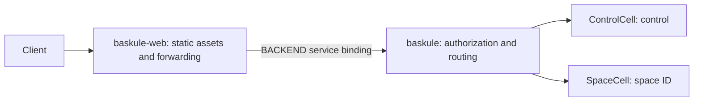

# celld runtime patches

Baskule's container builds celld 0.6.3 from upstream commit
`8702f6d186c77698dbfb30cf29e3b1922a88f008`, with
[`0001-preserve-warm-stateless-worker.patch`](../deploy/celld/patches/0001-preserve-warm-stateless-worker.patch) and
[`0002-service-deployments.patch`](../deploy/celld/patches/0002-service-deployments.patch), plus
[`0003-preserve-warm-cell-isolate.patch`](../deploy/celld/patches/0003-preserve-warm-cell-isolate.patch).
The source archive and Rust builder image are checksum-pinned in
[`deploy/celld/Dockerfile`](../deploy/celld/Dockerfile). The official celld runtime
image still supplies system dependencies and license notices.

## Warm-worker retention

Upstream's periodic pool maintenance can retire the last stateless isolate when
no JavaScript turns are running. The next request must compile the worker again.
For a large bundled application this can stall both application responses and
node health checks for seconds.

The patch gives the retirement decision a minimum live count. Routine stateless
maintenance preserves one compiled worker per loaded script and current
generation. Extra workers still retire one per maintenance pass. Superseded
generations retire completely after requests and resident cells drain.

The tradeoff is the retained memory of one stateless worker per loaded script
on each node. This is not an unbounded cache. There is no new setting, service,
database migration. A small vendored patch avoids
maintaining a separate celld fork. Remove it when a tested upstream release
provides equivalent behavior.

## Bounded cell-isolate retention

Patch 0003 retains at most one healthy empty cell heap per loaded script and current
node generation. Module scope and `globalThis` survive eviction; cell instances and
SQLite connections do not. Wake still constructs the cell and its per-Space services.
Both Baskule cell classes share the backend pool. Budget roughly 130 MiB per node for
the retained application heap, in addition to stateless workers and resident cells. Actual usage depends on the build.
The memory and idle-eviction decisions are tracked in [#87](https://github.com/baskule/baskule/issues/87).

After the last release, maintenance collects the empty heap on a blocking thread.
Retention requires no resident cells, requests, turns, or open native cell storage.
Used heap plus external memory must be at most 30% of the original heap limit, age
must stay below six hours, and adoptions must stay below 1,024. Failed release, failed
module graph, heap-limit failure, or terminated turn prevents empty retention.
A busy worker lock skips that maintenance pass. Additional empty heaps, superseded
generations, and pressure shedding retain no empty heap. Live isolates keep serving
when an application catches an optional import failure.

celld calls an optional synchronous `[Symbol.dispose]()` on cell release. The hook
removes in-memory registrations without network or storage I/O. Native storage,
facets, and stubs close even if it throws. Release cancels queued KV puts and rejects
stale SQL and KV operations. The stricter KV guard also applies to upstream reset,
explicit abort, and abandoned critical sections: stale access and delayed flushes
reject instead of silently dropping writes. Stored data and persistence formats do
not change.

Release discards only unowned operations and operations owned by that cell. Other
live events receive their operations through their existing driver mailboxes.
Operations owned outside the isolate's registry stay queued for normal adoption.
Maintenance does not pump application tasks or microtasks outside a request driver.

Baskule releases T3 routes, attachment roots, MCP bridges, shell captures, and the
agent environment key with the cell. Each cleanup step runs even if another fails.
Capture owners use weak references and boot-scoped ownership so stale streams cannot
write into a new Space incarnation. Keep this application cleanup and patch 0003
in the same release; retaining module state without releasing Space references is unsafe.
The shared SQL client, multiplexed alarm, and same-cell self-request are unchanged.

Idle eviction remains disabled unless `CELLD_IDLE_EVICT_S` is configured. Shipped
Helm, Compose, and worktree defaults do not enable it. Retention helps after eligible
idle or operator eviction, or placement onto a warm node. Pressure eviction frees
the heap. Enabling idle eviction requires the installation operator's choice.

## Native service deployment

Two ordinary, self-contained bundles use celld 0.6.3's existing service bindings:



`platform/wrangler.web.json` owns the public Worker and assets.
`platform/wrangler.json` keeps the existing backend script name, `ControlCell`
and `SpaceCell` classes, and cell names. No storage identity or database schema
changes. HTTP requests and WebSocket upgrades retain their original URL, body,
headers, and authentication checks through the service binding.

The web Worker does not import either cell implementation, T3, or OpenCode.
The backend still includes those dependencies. This separates static-page
startup from backend compilation; it does not remove backend cold-start costs.
celld also warms every reachable service during generation adoption, so total
node readiness still includes backend startup.

The second patch adds deployment CLI support, without changing JavaScript
loading or cell placement. `celld deploy --named-only` uploads a service and
updates its named pointer without selecting it as the public Worker. `celld dev
WEB_CONFIG --service BACKEND_CONFIG` publishes both to the same local store.
Both use the native bundle, service-binding, and deployment formats. The custom
lazy-module loader and facade classes are no longer part of the application.

Run only one deployment or rollback at a time per installation. Production
deployment publishes `baskule` first, then `baskule-web`. The public
config includes the backend deployment version so a backend-only change causes
nodes to rebuild their service graph. This is an ordered rollout, not an atomic
transaction across two pointers: a restarting node can temporarily combine the
previous web Worker with the new backend. Keep the forwarding interface
compatible across releases. The backend is never temporarily made public by
the service publication step.

Baskule's build also excludes OpenCode's disabled models.dev snapshot and provider
adapter loaders outside `BASKULE_AI_PROVIDERS`. It retains supported provider
families and their subpaths, registry keys, tools, plugins, and upstream source
packages. Build guards reject incompatible SDK layouts or catalog settings.
Unused provider callbacks reject explicitly. The real-SDK build tests verify the
retained imports and that accepted admin provider IDs match the package mapping.

## Build and verify

```sh
docker build --target source -f deploy/celld/Dockerfile -t baskule-celld:local .
```

The build runs the retention policy and native retention unit tests, a lifecycle
test using real V8 workers, and native service-publication tests. Coverage includes
retention floors, lock contention, foreign operations, stale storage after same-scope
re-adoption, failed cleanup with another resident cell, CPU termination, eligibility
bounds, generation drain, pressure policy, and named-only publication. These checks
do not simulate fleet memory pressure or a six-hour soak. The pinned public upstream
snapshot contains no reset or storage conformance suite; none is claimed as passing.

The native launcher (`scripts/celld.sh`) builds the `source` target on first use
and caches its binary by Dockerfile, patch and test contents. Subsequent launches
reuse it. This requires Docker. `CELLD_BIN` overrides the launcher for a compatible
binary you already built. For example:

```sh
mkdir -p .run/patched-celld
container=$(docker create baskule-celld:local)
docker cp "$container:/usr/local/bin/celld" .run/patched-celld/celld
docker rm "$container"
export CELLD_BIN="$PWD/.run/patched-celld/celld"
scripts/worktree runtime
scripts/check space
```

To inspect bundle composition without putting source paths in the deployed artifact:

```sh
mkdir -p .run/evidence/bundle
BASKULE_MINIFY=1 BASKULE_METAFILE="$PWD/.run/evidence/bundle/meta.json" node platform/scripts/build.mjs
```

Measure each self-contained Worker separately. Report raw and compressed bytes
and measured request latency; bundle size is not boot latency. Backend T3 and
OpenCode initialization must be measured separately from static asset responses.

Keep performance samples separate from compilation and other CPU-heavy checks.
Compare direct-node HTML, health checks, and edge responses across several
30-second maintenance intervals. Record errors, memory use, and worker
retirement events as well as latency.

## Deployment

Deployments require the installation operator's authorization. Upgrade the
deployment job and runtime image together, keeping the previous release image
and application artifact available. The runtime understands ordinary native
single-bundle deployments throughout; no custom module capability is required.
Update one node at a time and wait for health and application readiness.

Publish the backend with `--named-only`, then publish the web Worker normally.
The deploy job records the backend version in web vars and asks nodes to reload.
If publishing the web Worker fails, retry the coordinated deployment; existing
nodes continue serving their current generation. A node that reloads during
that interval can select the new backend, hence the compatibility requirement.

For rollback to a previous two-Worker release, republish **both** artifacts in
the same order. Restoring only the public pointer does not pin the backend: native
service bindings resolve the current named service pointer. To roll back to the
previous single-Worker release, publish that original `baskule` config normally,
which restores it as the public entry; the extra web service is then unreachable.
Verify existing accounts, spaces, conversations and WebSocket reconnects before
reverting the runtime image. Database files stay in place; this change requires
no data rollback.

For a runtime-only
update, preserve the installed release's application bundle and replace only
`/usr/local/bin/celld` in its image. Keep the original image available for rollback.
Update one node at a time, allowing its configured graceful shutdown and waiting
for health and application responses before proceeding to its peer. Verify
existing conversations and a new disposable conversation after the rollout.

A local image override must be removed or updated deliberately when installing
a later Baskule release; otherwise it continues selecting the older application
image. Rollback selects the original image and uses the same rolling sequence.
No data rollback is needed because the patches change no database storage format.
